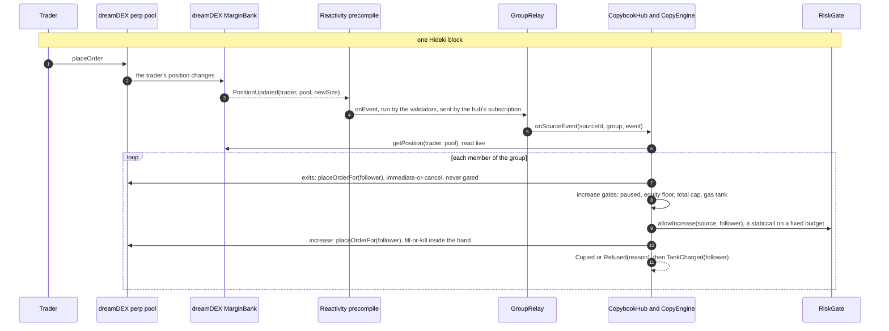
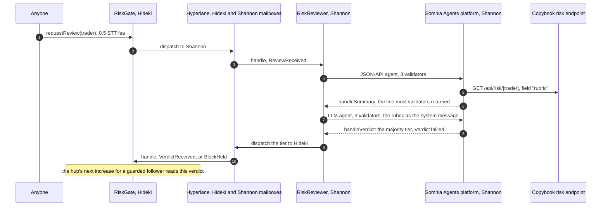
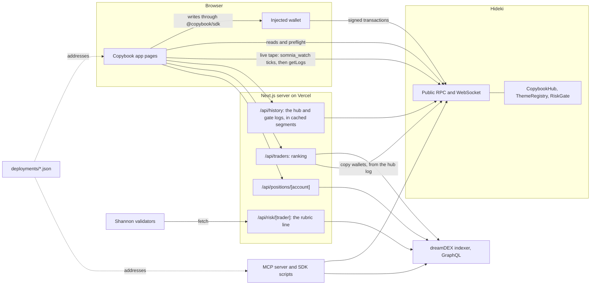

# Architecture

Copybook has no server in the copy path. A follower's copies are dreamDEX orders that the `CopybookHub` contract places
for the follower, from a handler that Somnia's validators run in the block of the source's move. Everything else (the
app, the SDK, the MCP server, the risk endpoint) reads the chain or the dreamDEX indexer, or sends a transaction from
the user's own wallet.

Addresses are in [`deployments/hideki.json`](../deployments/hideki.json) and
[`deployments/risk.json`](../deployments/risk.json). Every transaction cited below is checked in [PROOF.md](PROOF.md).

## Contracts

| Contract | Chain | Role |
| --- | --- | --- |
| `CopybookHub` | Hideki | Follows, groups, gas tanks, the reactive handler (`onSourceEvent`), `catchUp`, `poke`, `resync`. The operator followers approve on dreamDEX. |
| `CopyEngine` | Hideki | The per-follower sync, linked as an external library: it runs by `delegatecall` on the hub's storage and emits as the hub. |
| `PolicyLib` | Hideki | Policy validation, sizing and band prices. |
| `GroupRelay` | Hideki | One per group of followers of one source: up to 8 for a trader (`groupSize`), 2 for a thesis (`themeGroupSize`), whose member syncs are heavier. Only the Reactivity precompile can call it; it forwards the event to the hub tagged with its source and group. |
| `ThemeRegistry` | Hideki | Theses: up to 8 weighted legs, long or short, versioned by `rebalance`. |
| `RiskGate` | Hideki | Holds each trader's verdict, answers the hub's `allowIncrease`, holds each follower's guard switch, and takes review requests. |
| `RiskReviewer` | Shannon | Runs the two validator committees for a review and sends the verdict back. |

dreamDEX side: the `MarginBank` (positions and the `PositionUpdated` event), one perp pool per market (`placeOrderFor`),
and the `OperatorPermissionsRegistry` where the follower grants the hub the `placeOrderFor` selector.

## The same-block copy path

A follow puts the follower in a group of its source. The first member of a group opens it: the hub deploys the
group's `GroupRelay` (once; a reopened group reuses it) and subscribes it, through the Reactivity precompile, to the
source's event. For a trader that is `PositionUpdated` from the margin bank with the trader's address as topic 1; for
a thesis, `ThemeRebalanced` from the registry with the thesis id ([a follow that opens a group](PROOF.md#e2e-follow)).
The hub owns the subscription and keeps the precompile's 32 STT subscription balance.

What the handler guarantees, and where it is shown:

- **The source is read live.** The event only names the trader and the pool; the hub reads the trader's position at
  handler time, so a late or reordered event cannot open what the source no longer holds
  (`CopybookHub.onSourceEvent`).
- **Only the hub's own subscription drives a group.** `onSourceEvent` requires the caller to be the group's relay and
  `tx.origin` to be the hub, which Somnia sets for the subscription owner. Each recorded pair's copy is sent by the hub
  ([23 of 23](PROOF.md#same-block-copies)).
- **Exits never wait on a gate.** Each member runs in two self-calls: its exits first, then its increases. A failing
  increase cannot take a reduction with it
  (`contracts/test/HubFollow.t.sol::test_reductionIgnoresTankAndCaps`, [an exit under a BLOCK](PROOF.md#guard-exit)).
- **Increases are priced inside the band.** One fill-or-kill order at the follower's band edge; no fill is
  `Refused(BandUnfilled)` with the venue's error ([row](PROOF.md#refusal-band),
  `contracts/test/invariant/HubInvariant.t.sol::invariant_increaseWithinBand`).
- **The gate is asked before an increase only.** One `STATICCALL` from the hub on an open, none on a close
  ([the traces](PROOF.md#the-gate-in-the-copy-path); `measurements.gatedCopy` in `deployments/risk.json`). Anything but
  a clean `true` within the budget refuses the increase.
- **Each member pays its own gas.** The handler measures each member's share and charges it to that member's tank in
  the same transaction ([one handler run, two followers](PROOF.md#gas)).
- **Running short is deferred, never lost.** When the handler cannot fund the next member it stops with
  `GroupDeferred`; a member whose exits ran out of gas is `Deferred` and latched. Either way `catchUp` finishes the work
  on the caller's gas, and the app never labels that a same-block copy
  (`contracts/test/HubEdgeCases.t.sol::test_exitsOutOfGas_deferredUnbilled`,
  `app/test/tape.test.ts::a copy someone sent directly never claims the same block`).

A thesis rebalance runs the same path with `ThemeRebalanced`: the hub reads the thesis's legs and resizes every leg of
every member. Increases of a thesis follow fill as a set, or none of them do (`Refused(LegFailed)`)
([rebalance copied in its block](PROOF.md#thesis1-rebalance),
`contracts/test/HubTheme.t.sol::test_themeIncreasesAllOrNothing`).

Other ways a position moves, none of them same-block copies:

| Call | Who | What it does |
| --- | --- | --- |
| `follow` | the follower | A thesis: opens every leg now. A trader with named markets: copies those markets now. A whole-book trader follow opens nothing in this call. |
| `catchUp(follower, pools)` | anyone, on their own gas | Syncs the named markets to the source now, and finishes a latched follow. The dashboard offers it for the source's open book ([app run](PROOF.md#app-catchup)). |
| `poke(follower)` | anyone | Under the equity floor: closes every copied position and stops the follow until the follower resumes ([row](PROOF.md#floor-poke)). |
| `resync` | a thesis follower | A full sync of the thesis book at any time. |
| `unfollow(flatten)` | the follower | Leaves the group; with `flatten`, closes every copied position first ([row](PROOF.md#app-unfollow)). |

## The AI guard round trip

A review costs a fee (0.5 STT) and can be asked for by anyone. It crosses to Shannon, where the Somnia Agents
platform runs two committees of 3 validators each (2 answers needed), and the verdict crosses back.

- **What the gate does with a verdict.** OK and CAUTION never refuse. A BLOCK refuses new size to followers of that
  trader whose guard is on; a follower that never touched the switch is guarded. A BLOCK holds against a milder verdict
  for 24 hours and stops blocking after 7 days unless replaced (`contracts/src/risk/RiskGate.sol`,
  `contracts/test/risk/RiskGate.t.sol::test_blockHold_milderVerdictHeldFor24Hours`, `::test_staleBlock_allows`).
- **What crosses the chains.** The request carries the trader and a nonce. The verdict carries the trader, the nonce,
  the tier, the platform's request id and the hash of the line the committee agreed on. The validators fetch the line
  themselves. A verdict for anything but the trader's pending review is ignored (`StaleVerdict`).
- **When a review fails** (unfunded reviewer, committee timeout, no agreed line, no majority) the reply carries no
  verdict and the stored one stands.
- **One review, every hop:** [review 11](PROOF.md#one-review-end-to-end-review-11). All 43 reviews:
  [table](PROOF.md#every-review-43). Latency from request to verdict on Hideki: median 11 s over 19 reviews of run v3
  ([scorecard](../eval/SCORECARD.md#cost-and-latency)).

The rubric is public ([`eval/rubric.ts`](../eval/rubric.ts)) and the field the validators fetch holds only the keys
it reads, so anyone can recompute the tier a line should get. The scorecard measures how faithfully the committee applies it
([run v3](../eval/SCORECARD.md#result)). The lane's trust model is in [LIMITS.md](LIMITS.md).

## Data routes

- **Writes** go from the visitor's wallet, built by `@copybook/sdk`, which checks the wallet's chain and estimates
  gas on the node before asking for a signature (`app/components/follow/hooks.ts`).
- **Reads** of follows, tanks, verdicts, theses and marks go to the chain through the SDK (`app/lib/server/chain.ts`
  on the server, the same SDK in the browser). Trader statistics and open positions come from the dreamDEX indexer
  through `@copybook/stats`.
- **The live tape** reads `/api/history` once, then watches from where that read ended: a `somnia_watch` notification
  is only a tick, and each tick re-reads the logs from the last covered block, so every event is shown once
  (`packages/sdk/test/feed.test.ts::two consecutive reconnects with overlapping windows deliver every event exactly once`).
- **The hub's log** is read in fixed block segments. A segment far enough below the head is final and cached for good,
  and cumulative checkpoints keep a cold read to one checkpoint plus the open tail (`app/lib/server/hubLog.ts`).
- **The risk endpoint** is the only thing the validators read. It serves the rubric's keys (`rubric`) next to the full
  line for people (`summary`) and is cached for 5 minutes
  (`app/test/risk-route.test.ts::200 with the rubric line: only the keys the rubric reads, beside the full summary`).
- **Addresses** come from `deployments/` only, in the app, the SDK and the MCP server. Copybook's own wallets are
  listed there and are marked ours and never ranked
  (`app/test/config.test.ts::knows every wallet Copybook runs: excluded from rankings, marked ours, labelled on the tape`).

## Who can do what

| Actor | Can | Cannot |
| --- | --- | --- |
| The follower | follow, unfollow (with or without flatten), change the policy, fund and withdraw the tank (0.2 STT stays while following), resume after a stop, switch the guard, revoke the operator grant on dreamDEX | follow a second source from the same wallet |
| The hub | place orders for an approved follower in the markets its follow manages, from the handler or from `catchUp`, `poke`, `resync`, `follow` and `unfollow` | anything the `placeOrderFor` grant does not cover; it holds no follower margin |
| Anyone | `catchUp` and `poke` any follower (on their own gas), request a review | place an order a sync would not place: `catchUp` only moves a position toward the source (`contracts/test/HubFollow.t.sol::test_catchUp_onlyMovesTowardSource`) |
| The hub's owner | set the risk gate, the handler's gas budget and billing overhead (within the contract's bounds) and the subscription parameters, pause new follows, withdraw STT above the tanks and the subscription reserve, repair subscriptions | take a tank (`contracts/test/HubAdmin.t.sol::test_withdrawSurplus_keepsTanksAndReserve`), place orders, renounce ownership (`::test_renounceOwnership_disabled`) |
| The gate's owner | choose the reviewer whose messages count, set the fee, withdraw collected fees | deliver a verdict itself: `handle` accepts only a Hyperlane message from the reviewer on Shannon |
